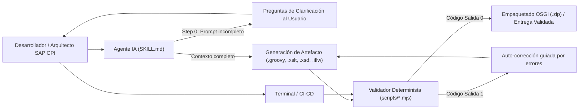

# Arquitectura del Proyecto (`sap-cpi-skills-pack`)

## 1. Visión General

`sap-cpi-skills-pack` combina **instrucciones estructuradas para Agentes de IA (`SKILL.md`)** con **motores de validación determinista en Node.js (`scripts/*.mjs`)** orientados a **SAP Cloud Integration (SAP Integration Suite / CPI)**.

El objetivo arquitectónico es eliminar las alucinaciones frecuentes de los modelos de lenguaje en entornos SAP CPI (como el uso de APIs inexistentes en Apache Camel, fugas de memoria por cargar payloads masivos en `String`, vulnerabilidades XXE en parsers XML, o cabeceras OSGi mal formadas en `META-INF/MANIFEST.MF`) exigiendo que cada artefacto generado pase por un validador estático antes de entregarse.



---

## 2. Principios de Diseño

### 2.1. Cero Dependencias Externas (Zero-Dependency Node.js)
Todos los scripts utilizan exclusivamente módulos nativos incluidos en **Node.js `v18+`**:
- `node:fs` y `node:path`: Lectura/escritura de artefactos y resolución multiplataforma de rutas.
- `node:zlib`: Compresión y descompresión raw DEFLATE (`deflateRawSync` / `inflateRawSync`).
- `node:child_process`: Orquestación de pruebas en `verify-all.mjs`.

Esto garantiza que el proyecto funcione inmediatamente tras hacer `git clone` sin necesidad de ejecutar `npm install`, evitando problemas con proxies corporativos o registros privados de paquetes.

### 2.2. Motor ZIP Nativo (`shared/zip-utils.mjs`) y Motor PDF Nativo (`shared/pdf-utils.mjs`)
SAP CPI distribuye sus artefactos (Integration Flows y Script Collections) como paquetes `.zip` que contienen estructuras OSGi (`META-INF/MANIFEST.MF`, `.project`, `src/main/resources/...`).

- **Motor ZIP ([`shared/zip-utils.mjs`](../shared/zip-utils.mjs))**: Implementa el estándar **PKWARE ZIP (Local File Headers, Central Directory y End of Central Directory Record)** directamente sobre `Buffer` en Node.js:
  - **Lectura (`readZipEntries`):** Soporta métodos `STORE (0)` y `DEFLATE (8)` y permite inspeccionar paquetes `.zip` anidados recursivamente en memoria.
  - **Escritura (`writeZipFile`, `createZipBuffer`):** Calcula sumas de verificación **CRC-32 IEEE 802.3**, comprime con `deflateRawSync`, garantiza que `.project` y `META-INF/MANIFEST.MF` queden en la raíz del `.zip` y aplica plegado de líneas a 72 bytes UTF-8 según RFC 2822.
- **Motor PDF ([`shared/pdf-utils.mjs`](../shared/pdf-utils.mjs))**: Generador nativo de documentos **PDF 1.4 (`WinAnsiEncoding`)** sin dependencias externas. Permite renderizar portadas corporativas, badges de puntuación, tablas estructuradas y bloques de código multipágina tanto para informes de auditoría (`inspect-iflow-zip.mjs --pdf`) como para especificaciones técnicas.

### 2.3. Privacidad por Defecto (`Privacy-First Inspection`) y Harness de Aprendizaje Continuo
- **Privacidad en archivos `.prop`**: Los valores de configuración dentro de archivos `.prop` (`parameters.prop`, `metainfo.prop`) se enmascaran automáticamente como `clave=[REDACTED]` y se transfieren íntegros a nivel de `Buffer` durante clonaciones o autorremediaciones.
- **Harness de Auto-Mejora Continua ([`AGENTS.md`](../AGENTS.md) y [`rules/sap-cpi-continuous-learning.md`](../rules/sap-cpi-continuous-learning.md))**: Cada vez que se detecta un error real en SAP CPI o se inspecciona un paquete de referencia, el agente abstrae la regla técnica (sin ningún dato de proyecto privado ni cliente), la programa en el validador CLI correspondiente y la registra en [`docs/LESSONS_LEARNED.md`](./LESSONS_LEARNED.md).

### 2.4. Portabilidad de Rutas entre el Repositorio y `.agents/` / `.claude/`
La carpeta `shared/` se ubica al mismo nivel jerárquico que `skills/`. Cuando se ejecuta [`setup-skills.mjs`](../setup-skills.mjs), el instalador copia tanto `skills/<nombre>` como `shared/zip-utils.mjs` dentro de `.agents/` y `.claude/`:

```text
<proyecto-destino>/
├── .agents/
│   ├── shared/zip-utils.mjs
│   └── skills/<skill-name>/scripts/*.mjs
└── .claude/
    ├── shared/zip-utils.mjs
    └── skills/<skill-name>/scripts/*.mjs
```

Gracias a esta simetría, las importaciones relativas `../../../shared/zip-utils.mjs` desde cualquier script funcionan de forma idéntica tanto al ejecutarse dentro de `sap-cpi-skills-pack` como una vez instaladas en otro proyecto.

---

## 3. Anatomía de cada Skill

Cada una de las 8 skills en `skills/<nombre-skill>/` sigue una estructura estandarizada de 3 capas:

1. **`SKILL.md` (Instrucciones Operativas del Agente):**
   - Frontmatter YAML con `name` y `description` optimizados para activación automática por contexto.
   - **Step 0 (`Interactive Discovery & Clarification Gate`):** Protocolo obligatorio que instruye al agente a evaluar si faltan parámetros funcionales o técnicos en el prompt del usuario (contratos de entrada/salida, versión de motor XSLT, adaptadores, cabeceras/propiedades, claves de correlación o manejo de errores) y formular preguntas concisas antes de asumir o generar código.
   - Reglas de arquitectura obligatorias y flujo de trabajo paso a paso.
   - Instrucción explícita de validar siempre la salida ejecutando su script CLI correspondiente.
2. **`scripts/*.mjs` (Herramientas CLI Deterministas):**
   - Analizadores estáticos, motores de puntuación, inferencia de esquemas o constructores de paquetes `.zip`.
   - Soportan salida legible en consola y modo estructurado `--json`.
   - Retornan código de salida `0` si el artefacto cumple las normas o `1` si existen errores críticos.
3. **`references/*.md` (Documentación de Referencia bajo Demanda):**
   - Catálogos de directivas, patrones canónicos, especificaciones OSGi y plantillas corporativas que el agente consulta solo cuando la tarea lo requiere, manteniendo limpio el contexto principal.
