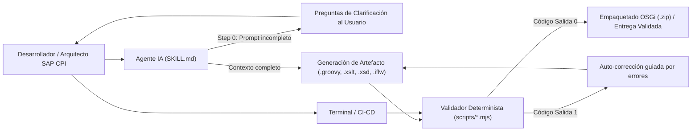

# Arquitectura del Proyecto (`sap-cpi-skills-pack`)

## 1. Visión General

`sap-cpi-skills-pack` combina **instrucciones estructuradas para Agentes de IA (`SKILL.md`)** con **motores de validación determinista en Node.js (`scripts/*.mjs`)** orientados a **SAP Cloud Integration (SAP Integration Suite / CPI)**.

El objetivo arquitectónico es eliminar las alucinaciones frecuentes de los modelos de lenguaje en entornos SAP CPI (como el uso de APIs inexistentes en Apache Camel, fugas de memoria por cargar payloads masivos en `String`, vulnerabilidades XXE en parsers XML, o cabeceras OSGi mal formadas en `META-INF/MANIFEST.MF`) exigiendo que cada artefacto generado pase por un validador estático antes de entregarse.



---

## 2. Principios de Diseño

### 2.1. Cero Dependencias Externas (Zero-Dependency Node.js)
Todos los scripts utilizan exclusivamente módulos nativos incluidos en **Node.js `v18+`**:
- `node:fs` y `node:path`: Lectura/escritura de artefactos y resolución multiplataforma de rutas.
- `node:zlib`: Compresión y descompresión raw DEFLATE (`deflateRawSync` / `inflateRawSync`).
- `node:child_process`: Orquestación de pruebas en `verify-all.mjs`.

Esto garantiza que el proyecto funcione inmediatamente tras hacer `git clone` sin necesidad de ejecutar `npm install`, evitando problemas con proxies corporativos o registros privados de paquetes.

### 2.2. Motor ZIP Nativo (`shared/zip-utils.mjs`) y Motor PDF Nativo (`shared/pdf-utils.mjs`)
SAP CPI distribuye sus artefactos (Integration Flows y Script Collections) como paquetes `.zip` que contienen estructuras OSGi (`META-INF/MANIFEST.MF`, `.project`, `src/main/resources/...`).

- **Motor ZIP ([`shared/zip-utils.mjs`](../shared/zip-utils.mjs))**: Implementa el estándar **PKWARE ZIP (Local File Headers, Central Directory y End of Central Directory Record)** directamente sobre `Buffer` en Node.js:
  - **Lectura (`readZipEntries`):** Soporta métodos `STORE (0)` y `DEFLATE (8)` y permite inspeccionar paquetes `.zip` anidados recursivamente en memoria.
  - **Escritura (`writeZipFile`, `createZipBuffer`):** Calcula sumas de verificación **CRC-32 IEEE 802.3**, comprime con `deflateRawSync`, garantiza que `.project` y `META-INF/MANIFEST.MF` queden en la raíz del `.zip` y aplica plegado de líneas a 72 bytes UTF-8 según RFC 2822.
- **Motor PDF ([`shared/pdf-utils.mjs`](../shared/pdf-utils.mjs))**: Generador nativo de documentos **PDF 1.4 (`WinAnsiEncoding`)** sin dependencias externas. Permite renderizar portadas corporativas, badges de puntuación, tablas estructuradas y bloques de código multipágina tanto para informes de auditoría (`inspect-iflow-zip.mjs --pdf`) como para especificaciones técnicas.

### 2.3. Privacidad por Defecto (`Privacy-First Inspection`) y Harness de Aprendizaje Continuo
- **Privacidad en archivos `.prop`**: Los valores de configuración dentro de archivos `.prop` (`parameters.prop`, `metainfo.prop`) se enmascaran automáticamente como `clave=[REDACTED]` y se transfieren íntegros a nivel de `Buffer` durante clonaciones o autorremediaciones.
- **Limpieza Reversible de Bundles Reales ([`shared/cpi-sanitizer.mjs`](../shared/cpi-sanitizer.mjs), [`rules/sap-cpi-privacy-sanitize.md`](../rules/sap-cpi-privacy-sanitize.md))**: antes de leer una exportación real, el agente pregunta si limpiarla. El flujo es *limpiar → trabajar → restaurar*:
  1. `sanitize-iflow-zip.mjs` (MCP `cpi_sanitize_zip`) sustituye valores de `.prop` (y su reutilización en otros archivos), secretos (PEM, claves AWS, JWT, Bearer, `password=`…), hosts de URLs, URNs no estándar, emails, IPv4, alias de credenciales del `.iflw` y los términos de `--terms` por alias deterministas y sintácticamente válidos (`host-NNN.sanitized.invalid`, `user-NNN@sanitized.invalid`, `198.51.100.N`, `urn:sanitized:ns-NNN`, `SANITIZED_{CRED,PARAM,SECRET,TERM}_NNN`). Varios zips en una misma llamada comparten el mapa.
  2. Los namespaces y URIs estándar (W3C, OMG, SAP, Apache, OASIS, `xml.org`…) y los metadatos de adaptador (`cmdVariantUri`, `Vendor`) no se tocan, para no alterar el comportamiento en runtime (p. ej. features de protección XXE). `MANIFEST.MF` se transforma por línea lógica y se vuelve a plegar a 72 bytes; los zips anidados se procesan recursivamente.
  3. El mapa (`*.sanitize-map.json`, o `sanitize-map.json` con `--out-dir`; valores originales) queda solo en local y está ignorado en `.gitignore`. `--restore` (MCP `cpi_restore_zip`) reaplica los valores también en archivos editados, re-añade las muestras retiradas con `--drop-samples` y avisa de alias desaparecidos.
  4. **Guardas**: `inspect-iflow-zip.mjs` marca cualquier alias pendiente (incluso en zips anidados) como `SANITIZED-001` (CRÍTICO) y `build-cpi-package.mjs` devuelve `valid: false`, de modo que un bundle limpio nunca llega al tenant por error.
- **Estándar de Documentación de Código ([`shared/doc-standard.mjs`](../shared/doc-standard.mjs), [`rules/sap-cpi-code-documentation.md`](../rules/sap-cpi-code-documentation.md))**: una única implementación construye la cabecera canónica de Groovy (`/** */`) y XSLT (`<!-- -->`), deduce el esqueleto del código (`--doc-header`) y audita la documentación (`DOC_*` / `XSLT_DOC_*`). La usan `validate-groovy.mjs`, `audit-groovy.mjs`, `validate-xslt.mjs` y el MCP (`docs`, `docHeader`). Las reglas de secretos y datos sensibles en comentarios están siempre activas; el resto, con `--docs`.
- **Harness de Auto-Mejora Continua ([`AGENTS.md`](../AGENTS.md) y [`rules/sap-cpi-continuous-learning.md`](../rules/sap-cpi-continuous-learning.md))**: Cada vez que se detecta un error real en SAP CPI o se inspecciona un paquete de referencia, el agente abstrae la regla técnica (sin ningún dato de proyecto privado ni cliente), la programa en el validador CLI correspondiente y la registra en [`docs/LESSONS_LEARNED.md`](./LESSONS_LEARNED.md).

### 2.4. Arquitectura Dual (Skills Multi-IDE + Servidor MCP Local `stdio`)
La carpeta `shared/` y `mcp-server.mjs` se ubican al mismo nivel jerárquico que `skills/`. Cuando se ejecuta [`setup-skills.mjs`](../setup-skills.mjs), el instalador adapta y despliega los artefactos para todos los IDEs y asistentes de IA modernos:

```text
<proyecto-destino>/
├── AGENTS.md                                # OpenAI Codex CLI / GPT Agents / Antigravity
├── .mcp.json                                # Autodescubrimiento MCP (Claude Code; ruta absoluta al servidor)
├── .agents/
│   ├── mcp-server.mjs                       # Servidor MCP local (stdio JSON-RPC 2.0)
│   ├── rules/sap-cpi-continuous-learning.md # Harness de auto-mejora continua
│   ├── rules/sap-cpi-privacy-sanitize.md    # Regla de limpieza reversible de bundles reales
│   ├── rules/sap-cpi-code-documentation.md  # Estándar de documentación de Groovy y XSLT
│   ├── shared/*.mjs                         # Motores nativos ZIP, PDF 1.4, XML, regex y sanitizador
│   └── skills/<skill-name>/scripts/*.mjs    # Las 8 skills y sus motores CLI
├── .claude/                                 # Simétrico a .agents/ para Claude Code
├── .cursor/
│   ├── mcp.json                             # Registro automático del servidor MCP en Cursor
│   └── rules/*.mdc                          # Reglas MDC activadas por globs (*.groovy, *.iflw, *.xsd, *.mmap)
├── .github/
│   ├── copilot-instructions.md              # Instrucciones globales para GitHub Copilot
│   └── instructions/sap-cpi.instructions.md # Instrucciones tipadas para Copilot Agent Mode
├── .vscode/mcp.json                         # Registro automático del servidor MCP en VS Code
├── .windsurf/rules/sap-cpi.md               # Reglas para Windsurf IDE
└── .clinerules/sap-cpi.md                   # Reglas para Cline / Roo Code
```

Gracias a este diseño híbrido:
1. **Las Skills y Reglas (`.agents/skills`, `AGENTS.md`, `.cursor/rules`, `.github/copilot-instructions.md`)** proporcionan la metodología arquitectónica (los 3 pasos de diseño, el *Clarification Gate* previo y el protocolo de aprendizaje continuo).
2. **El Servidor MCP Local (`mcp-server.mjs`)** permite que el IDE invoque las 22 herramientas de validación y empaquetado directamente por JSON-RPC 2.0 sobre `stdin`/`stdout` en local, sin abrir puertos de red y sin pedir confirmación de terminal en cada comando. Valida los argumentos contra `inputSchema` (`-32602`), responde `-32700`/`-32600` ante JSON o peticiones inválidas y restringe las rutas a `CPI_MCP_ROOT`, que `setup-skills.mjs --mcp` escribe en `env` de cada `mcp.json` generado.

---

## 3. Anatomía de cada Skill

Cada una de las 8 skills en `skills/<nombre-skill>/` sigue una estructura estandarizada de 3 capas:

1. **`SKILL.md` (Instrucciones Operativas del Agente):**
   - Frontmatter YAML con `name` y `description` optimizados para activación automática por contexto.
   - **Step 0 (`Interactive Discovery & Clarification Gate`):** Protocolo obligatorio que instruye al agente a evaluar si faltan parámetros funcionales o técnicos en el prompt del usuario (contratos de entrada/salida, versión de motor XSLT, adaptadores, cabeceras/propiedades, claves de correlación o manejo de errores) y formular preguntas concisas antes de asumir o generar código.
   - Reglas de arquitectura obligatorias y flujo de trabajo paso a paso.
   - Instrucción explícita de validar siempre la salida ejecutando su script CLI correspondiente.
2. **`scripts/*.mjs` (Herramientas CLI Deterministas):**
   - Analizadores estáticos, motores de puntuación, inferencia de esquemas o constructores de paquetes `.zip`.
   - Soportan salida legible en consola y modo estructurado `--json`.
   - Retornan código de salida `0` si el artefacto cumple las normas o `1` si existen errores críticos.
3. **`references/*.md` (Documentación de Referencia bajo Demanda):**
   - Catálogos de directivas, patrones canónicos, especificaciones OSGi y plantillas corporativas que el agente consulta solo cuando la tarea lo requiere, manteniendo limpio el contexto principal.
